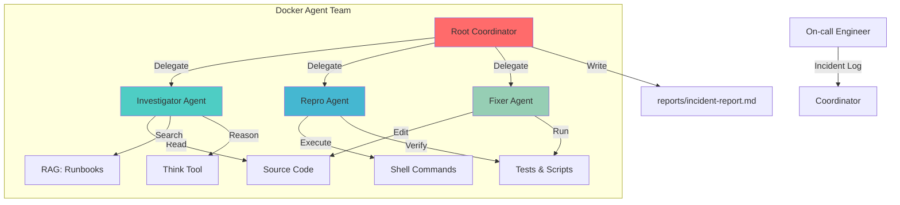

# Incident Debugger Agent

A multi-agent incident triage system built with [Docker Agent](https://docs.docker.com/ai/docker-agent/) that autonomously investigates, reproduces, and fixes production bugs.

## 🎯 Problem Statement

During on-call rotations, developers often face these challenges:
- **Slow triage**: Pasting logs into chatbots without code context or runbooks
- **Context loss**: Generic AI assistants can't access your specific codebase
- **No reproduction**: Unable to verify bugs in isolation
- **Cloud dependency**: Sensitive incident data sent to external APIs

This project demonstrates a specialized agent team that:
1. **Reads** incident logs + source code + runbooks
2. **Reproduces** bugs in isolated environments
3. **Fixes** issues with minimal, surgical changes
4. **Documents** everything in a structured incident report

## 🏗️ Architecture



### Agent Roles

| Agent | Responsibility | Tools |
|-------|---------------|-------|
| **Root** | Orchestrates workflow, generates reports | Filesystem, Think, RAG |
| **Investigator** | Finds root cause via code/logs/runbooks | Filesystem, Think, RAG |
| **Repro** | Reproduces bugs with tests/scripts | Shell, Filesystem |
| **Fixer** | Applies minimal fixes and verifies | Filesystem, Shell, Think |

## 🚀 Quick Start

### Prerequisites
- Docker & Docker Compose
- Node.js 20+ (for local development)
- Docker Agent CLI ([installation](https://docs.docker.com/ai/docker-agent/))
- API key (Anthropic or OpenAI) or Docker Model Runner for local models

### 1. Clone and Setup
```bash
git clone https://github.com/GabrielSSouza03/incident-debugger-agent.git
cd incident-debugger-agent
cp .env.example .env
# Edit .env with your API keys
```

### 2. Start the Sample Service
```bash
docker-compose up -d
npm install
npm run start:dev

# Wait for the service to be ready
curl http://localhost:3000/health
```

### 3. Seed Test Data
```bash
./scripts/seed-data.sh
```

### 4. Run the Agent
```bash
# Analyze an incident interactively (sandbox recommended for isolation)
docker-agent run agent.yaml --sandbox --agent root

# Or run in headless mode with a specific incident
cat incidents/incident-001-race-condition.log | docker-agent run agent.yaml --sandbox --agent root --exec \
  "Analyze this incident log and generate a full triage report"

# Without sandbox (uses host filesystem directly)
docker-agent run agent.yaml --agent root
```

## 🎬 Demo Script (for LinkedIn Video)

This script reproduces a realistic incident workflow for recording:

```bash
# Terminal 1: Start the application
docker-compose up

# Terminal 2: Seed data and trigger the race condition bug
./scripts/seed-data.sh
./scripts/reproduce-bugs.sh

# Terminal 3: Run the agent to investigate and fix
cat incidents/incident-001-race-condition.log | docker-agent run agent.yaml --sandbox --agent root --exec \
  "Investigate this payment failure incident, reproduce it, and propose a fix"

# Review the generated incident report
cat reports/incident-report.md
```

**Expected Output:**
- **Root Cause**: Payment errors caught but not propagated (line 35 in `orders.service.ts`)
- **Reproduction**: Race condition test demonstrates the issue
- **Fix**: Remove silent error swallowing, add transaction rollback
- **Prevention**: Use database transactions for multi-step operations

## 🐛 Intentional Bugs

This project contains **3 deliberate bugs** for demonstration:

### Bug 1: Race Condition on Payment Failure
- **Location**: `src/orders/orders.service.ts:35`
- **Issue**: Try-catch block swallows payment errors, order marked completed anyway
- **Incident**: `incidents/incident-001-race-condition.log`
- **Test**: `test/orders.bug.spec.ts` - `[BUG-001]`

### Bug 2: Database Connection Pool Exhaustion
- **Location**: `src/orders/orders.service.ts:67`
- **Issue**: Heavy query spawns 20 concurrent 2-second queries, exhausts pool
- **Incident**: `incidents/incident-002-db-timeout.log`
- **Reproduce**: `GET /orders/debug/heavy-query`

### Bug 3: Error Swallowing
- **Location**: `src/orders/orders.service.ts:35-37`
- **Issue**: Payment failures logged but not thrown, causing data inconsistency
- **Incident**: `incidents/incident-003-error-swallowing.log`
- **Test**: `test/orders.bug.spec.ts` - `[BUG-001]`

**Run intentional bug tests:**
```bash
npm run test:bugs
```

## 📚 Runbooks

The agent uses these runbooks as RAG context:
- `docs/runbooks/payment-failures.md` - Payment processing troubleshooting
- `docs/runbooks/database-performance.md` - DB connection pool issues
- `docs/runbooks/error-handling.md` - Error handling best practices

## 🔒 Privacy: Local Model Support

For sensitive incident data, use Docker Model Runner for local inference:

```bash
# Install Docker Model Runner and pull a model
docker model pull ai/qwen3

# Run agent with local model (uses dmr/ai/qwen3 from models.local)
docker-agent run agent.yaml --model local --agent root --sandbox
```

The `local` model is configured in `agent.yaml` to use Docker Model Runner. No data leaves your machine.

## 🤖 GitHub Actions Integration

Automated incident triage via GitHub Actions:

1. Go to **Actions** → **Incident Triage Agent**
2. Click **Run workflow**
3. Select incident file and model provider
4. Download the generated report from artifacts

**Setup:**
Add secrets in **Settings** → **Secrets and variables** → **Actions**:
- `ANTHROPIC_API_KEY` or `OPENAI_API_KEY`

## 📤 Sharing the Agent

Publish the agent for team use:

```bash
docker-agent share push
```

The agent will be published to the Docker Agent registry and can be shared with others.

## 🧪 Testing

```bash
# Run normal tests (excludes bug reproduction tests)
npm test

# Run intentional bug tests
npm run test:bugs

# Run all tests
npm run test:all
```

## 🛠️ Development

```bash
# Install dependencies
npm install

# Start in dev mode
npm run start:dev

# Lint and format
npm run lint
npm run format

# Build
npm run build
```

## 📦 Project Structure

```
incident-debugger-agent/
├── agent.yaml                 # Docker Agent configuration
├── src/                       # NestJS application
│   ├── orders/               # Orders module with bugs
│   ├── health/               # Health check endpoint
│   └── main.ts               # Application entry point
├── incidents/                 # Sample incident logs
│   ├── incident-001-race-condition.log
│   ├── incident-002-db-timeout.log
│   └── incident-003-error-swallowing.log
├── docs/
│   ├── runbooks/             # Runbooks for RAG context
│   └── architecture/         # Architecture diagrams
├── scripts/                   # Reproduction scripts
│   ├── seed-data.sh
│   └── reproduce-bugs.sh
├── test/                      # Test files
│   └── orders.bug.spec.ts    # Bug reproduction tests
└── docker-compose.yml         # Local development setup
```

## 🎓 Learning Resources

- [Docker Agent Documentation](https://docs.docker.com/ai/docker-agent/)
- [Docker Agent Examples](https://github.com/docker/docker-agent/tree/main/examples)
- [NestJS Documentation](https://docs.nestjs.com/)

## 📝 License

MIT

## 👤 Author

**Gabriel Simões**
- Backend Software Engineer
- Specializes in Node.js, TypeScript, NestJS, Docker
- GitHub: [@GabrielSSouza03](https://github.com/GabrielSSouza03)

---

*Built as a portfolio project demonstrating multi-agent systems for incident response.*
